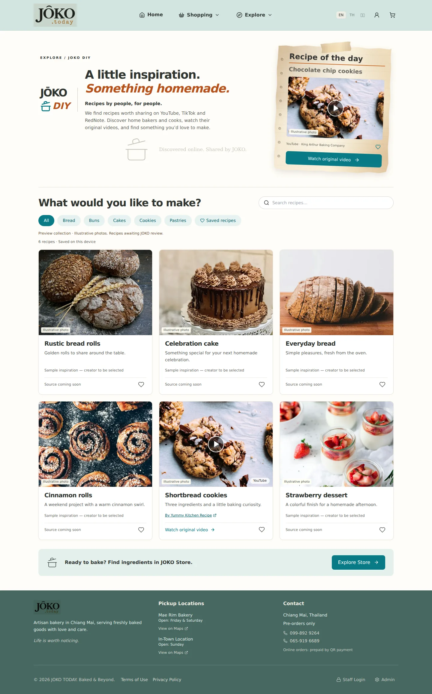
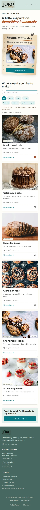

# JOKO DIY frontend v1 — creator discovery page

Route: `/diy`. Photo-led recipe discovery with a taped notebook feature. This branch is an editorial preview for page review.

## Current scope

- Shared sticky turquoise JOKO header and existing navigation/account/cart controls.
- Scoped sans-serif typography and orange italic headline; existing notebook paper and translucent tape, matching the homepage note. No global typography changes.
- “Recipes by people, for people.” Intro explains that JOKO discovers and shares original creator recipes from YouTube, TikTok and RedNote.
- Responsive photographic catalog tiles, search, categories and browser-local saved recipes.
- Source creator and platform stay visible. Two sample entries have original YouTube links and a click-to-load video viewer with direct creator link. No iframe is loaded before user action.
- Five illustrative sample tiles have no selected source yet, say so clearly and do not open a fabricated recipe/video.
- EN/TH/ZH interface and positioning copy; placeholder titles/descriptions remain English with a disclosure.
- Separate Store crosslink uses the existing non-bakery catalog navigation.

Detailed recipe cards, ingredients/method layouts, timings and yields are deferred for a later design phase. The video viewer contains only the original video and source attribution. TikTok/RedNote import and embedding are not implemented yet.

## Preview content

All stock photos are visibly labelled illustrative. Replace them with approved recipe-specific photography before launch; the shortbread placeholder is a generic cookie photo. Source URLs and creator identities remain independent of placeholder imagery. The text DIY wordmark awaits the approved transparent logo.

The page does not read/write recipes in Supabase. No publishing admin, AI ingestion, translated recipe content, account-synced likes or ingredient-to-product mapping is included. No production data, payment, auth, infrastructure, dependency or schema changes.

## Validation — 2026-10-21

- TypeScript, scoped ESLint, production build and diff checks passed. Existing large-chunk warning remains.
- Chromium at desktop 1440×1100 and mobile 390×844: search, category filters, empty/reset state and save persistence passed.
- Original-video query-string links, Escape/Back/direct-link close, sticky header (top 0 after scrolling) and no mobile horizontal overflow verified.
- Shared tape computes to `display: block`; the metal-clip pseudo-element is absent.
- Source creator credit appears in the catalog. No ingredient/method card is rendered in the viewer.
- EN/TH/ZH interface renders; no page JavaScript errors observed.
- Backend and iframe responses were stubbed for local UI tests. Actual platform playback and production branding are not claimed verified. Screenshots use fallback shell branding.

## Next

Approve the DIY discovery page, provide the approved logo and select the first properly credited source collection. Design standardized recipe cards separately afterward.

