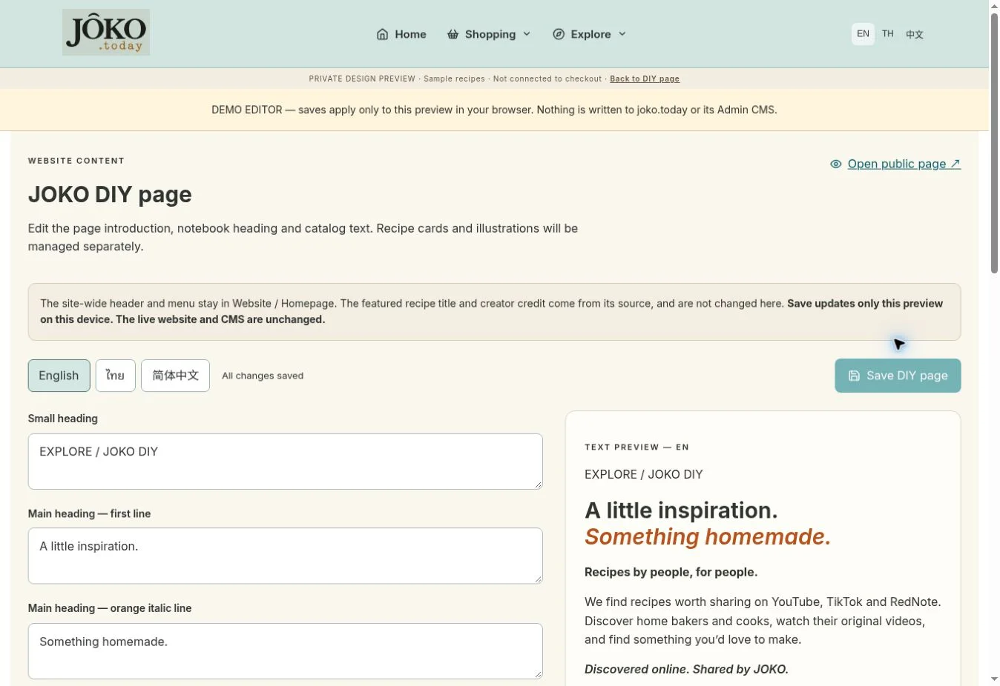

# JOKO DIY frontend v1 — creator discovery page

Route: `/diy`. Photo-led recipe discovery with a taped notebook feature. This branch is an editorial preview for page review.

## Current scope

- Shared sticky turquoise JOKO header and existing navigation/account/cart controls.
- Scoped sans-serif typography and orange italic headline; existing notebook paper and translucent tape, matching the homepage note. No global typography changes.
- “Recipes by people, for people.” Intro explains that JOKO discovers and shares original creator recipes from YouTube, TikTok and RedNote.
- Responsive photographic catalog tiles, search, categories and browser-local saved recipes.
- Source creator and platform stay visible. Two sample entries have original YouTube links and a click-to-load video viewer with direct creator link. No iframe is loaded before user action.
- Five illustrative sample tiles have no selected source yet, say so clearly and do not open a fabricated recipe/video.
- EN/TH/ZH interface and positioning copy; placeholder titles/descriptions remain English with a disclosure.
- Separate Store crosslink opens the dedicated `/store` catalog.

Detailed recipe cards, ingredients/method layouts, timings and yields are deferred for a later design phase. The video viewer contains only the original video and source attribution. TikTok/RedNote import and embedding are not implemented yet.

## Preview content

All stock photos are visibly labelled illustrative. Replace them with approved recipe-specific photography before launch; the shortbread placeholder is a generic cookie photo. Source URLs and creator identities remain independent of placeholder imagery. The text DIY wordmark awaits the approved transparent logo.

The page does not read/write recipes in Supabase. No publishing admin, AI ingestion, translated recipe content, account-synced likes or ingredient-to-product mapping is included. No production data, payment, auth, infrastructure, dependency or schema changes.

## Validation — 2026-10-21

- TypeScript, scoped ESLint, production build and diff checks passed. Existing large-chunk warning remains.
- Chromium at desktop 1440×1100 and mobile 390×844: search, category filters, empty/reset state and save persistence passed.
- Original-video query-string links, Escape/Back/direct-link close, sticky header (top 0 after scrolling) and no mobile horizontal overflow verified.
- Shared tape computes to `display: block`; the metal-clip pseudo-element is absent.
- Source creator credit appears in the catalog. No ingredient/method card is rendered in the viewer.
- EN/TH/ZH interface renders; no page JavaScript errors observed.
- Backend and iframe responses were stubbed for local UI tests. Actual platform playback and production branding are not claimed verified. Screenshots use fallback shell branding.

## Next

Approve the DIY discovery page, provide the approved logo and select the first properly credited source collection. Design standardized recipe cards separately afterward.

## Admin page content

`/admin/diy` adds a dedicated editor under the existing authenticated Admin workspace. Twelve editable text fields cover the hero heading/intro, community statement, discovery note, notebook heading/video action, catalog heading/search placeholder and Store invitation/button. English, Thai and Simplified Chinese use wide fields with language tabs and an unsaved text preview. Header/menu branding remains in Website / Homepage; creator names and the featured recipe title remain source content, separate from editorial copy.

Save writes all language rows in one `cms_labels` upsert using fixed `diy_page_*` keys and the existing admin-only INSERT/UPDATE RLS. Missing translations fall back to bundled language defaults. No migration, seed, policy, privileged credential or production write was performed. Public `/diy` reads these keys on mount and refreshes after focus or an in-app content-save event.

Saving updates the public copy directly; there is no separate Publish step. The editor explicitly says so. It disables edits if initial loading fails, preserves drafts on save errors, validates all languages, verifies the returned save rows, confirms success, warns before browser unload and before changing Admin tabs. The existing labels editor could still edit the same keys; simultaneous saves follow the existing last-write-wins CMS behavior.

Validation: TypeScript/build/scoped lint plus mocked browser tests verified three-language save/reload, no autosave, blank validation, failed-save draft retention, rejection of an unverified save response, mobile editor overflow, public-page readback, Chinese content and failed-load protection. The real Admin route denied an unauthenticated test session. Actual authenticated persistence and live RLS remain staging acceptance checks; only mocked backend responses were used.

Private preview `?edit=diy` offers a browser-local demo of this editor. Its saves affect only that preview on the same device, not the CMS or live website.

## Store integration review — 2026-10-22

Reconciled with `main` at `a2de8cc` (Store #295, homepage cleanup #317 and Store migration quoting fix #318). Resolved the App route conflict by preserving both Store and DIY in the shared shell. Updated the DIY Store invitation to navigate to `/store` instead of the old non-bakery filter. Store catalog, cart, checkout, payment, inventory and migrations are unchanged relative to main.

Fresh validation on the combined tree: locked install; TypeScript; full ESLint (0 errors, 38 existing warnings); production build (existing large-chunk warning); design-system/static-asset, LINE auth/onboarding/friendship, auth-email and Tailwind audits; payment-email regression; Makers isolated PostgreSQL regression; 38 receipt compatibility assertions; Stripe SDK contract and 45 Edge assertions. Dependency audit reports 0 vulnerabilities. Final DIY diff passes whitespace checks.

This review did not perform a new browser acceptance test or write production data. Earlier mocked editor/UI tests remain documented above. Real authenticated CMS save/readback and original video playback remain staging acceptance checks. Five catalog entries still have no selected video source; photos/logo remain editorial placeholders. Merge readiness and public content launch readiness are separate decisions. No merge or production deployment was performed by this review.
