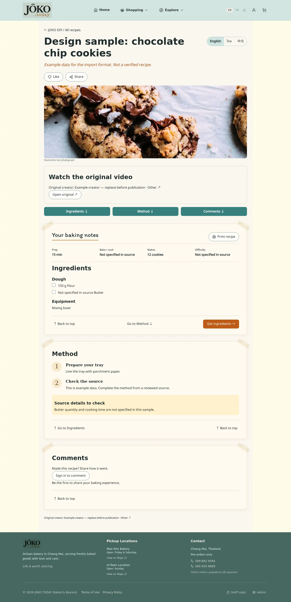
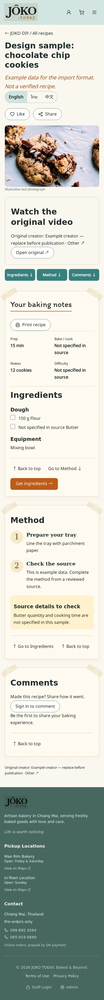
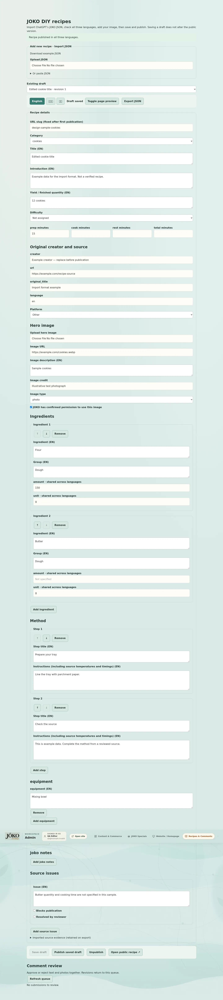

# JOKO DIY recipe cards v1 — implementation review

Status: feature branch deployed to isolated staging for acceptance testing. No production database, Storage, CMS, migration, publishing or deployment changes were performed.

## Implemented

- Admin → Recipes & Comments at `/admin/diy/recipes` imports a JSON file or pasted JSON into a NEW UNSAVED draft. Imports never overwrite existing recipes or publish automatically. Invalid files preserve the current editor state.
- Versioned `joko.recipe.v1` format, downloadable example and JSON Schema under `/templates/`. Strict parser rejects unknown fields, malformed nested lists, duplicate IDs, unsafe source/image links and unsupported versions. Source quantities/units are shared across languages; English, Thai and Simplified Chinese text has explicit fields.
- Wide editable fields, language tabs, ingredient grouping/order/add/remove, step order/add/remove, equipment, source/JOKO notes, yield, timings, difficulty and source issues. Blank source quantities/timings remain unknown. Imported evidence is retained in drafts/export and stripped from public snapshots.
- Source/creator/hero metadata editing and image upload through the existing JOKO media pipeline. Image permission and credit must be checked before publication. Difficulty is optional and assigned by the reviewer, never guessed on import.
- Save draft leaves the current public snapshot unchanged. Explicit Publish copies a saved revision after publication checks. Concurrent/stale saves and publishes are rejected. Unpublish hides the snapshot but keeps the draft. Published slugs cannot change.
- Published recipes open at `/diy/recipes/<slug>` in the shared JOKO shell. Notebook paper/tape, matching Ingredients/Method headings, warm numbered markers, shared language selector, print view, Like/Share controls, Ingredients/Method/Comments jumps, return links and Store CTA. Empty optional fields are omitted or show “not specified in source”.
- Native share sheet with Facebook/LINE/copy-link fallback. Only the requested action opens an external sharing surface.
- Original creator attribution always visible. YouTube uses click-to-load official privacy-enhanced embeds. TikTok/RedNote/Other currently use the prominent original-source LINK fallback; no unofficial iframe or arbitrary HTML is accepted.
- The discovery page uses published records when any exist; preview fixtures remain when none exist or the new backend is unavailable. Existing preview bookmarks are preserved. Public recipes use stable UUIDs; fixtures are not silently converted into published recipes.
- Signed-in customers can submit comments with up to four photos, 5 MiB maximum per original. JPEG/PNG/WebP and HEIC/HEIF conversion; images are re-encoded as WebP (longest edge ≤1,600 px, ≤500 KiB) before upload. This strips original metadata and generates 96 px display thumbnails from optimized images. A separate thumbnail object is not stored in v1. HEIC converter is a pinned, dynamically imported dependency (only loaded for HEIC).
- Text and photos remain private until admin approval. Public snapshots exclude account IDs and private submission state. Owners can edit text (returns to moderation) or withdraw. Photo attachments are immutable after submission; to change attachments, withdraw and submit again. Videos are deferred.
- Admin can preview submission photos and approve/reject/hide text+photos atomically. Optimistic moderation revision checks prevent approving an out-of-date version. An owner’s edit hides the approved snapshot immediately until reapproval.

## Data and authorization

Prepared migration: `20261023032148_joko_diy_recipes_comments_v1.sql` (created with Supabase CLI).

- `diy_recipe_drafts`: admin-only editable JSON and revision.
- `diy_recipes`: published JSON snapshots; public SELECT only for published rows.
- `diy_comment_submissions`: owner/admin SELECT, no direct customer writes. Mutation RPCs verify ownership and transitions. Reviewer actions require the existing `user_profiles.role = admin` boundary.
- `diy_recipe_comments`: approved public text and display-name snapshots; no user UUID/email.
- Private `diy-comment-photos` Storage bucket, WebP MIME only and 512 KiB storage ceiling. Four fixed upload slots per submission, insert-only while uploading. No user replacement/upsert/delete after review. Anonymous reads require an approved, published comment; owners/admins may inspect private photos. Media is downloaded through RLS, not permanent public or long-lived signed links.
- Narrow private SECURITY DEFINER helpers are necessary to inspect private submissions for anonymous Storage authorization and to atomically transition comment snapshots. They use empty search_path, explicit caller/role checks, qualified identifiers and revoked default PUBLIC EXECUTE. Public wrappers are SECURITY INVOKER. No service-role credentials in browser code.
- Comment creation is serialized per account and limited to ten attempts/hour. Attempt records survive comment withdrawal to prevent limit bypass. Admin maintenance should remove old attempt records and orphan photos according to retention policy; no recurring maintenance was installed. Uploaded files from a failed/withdrawn submission remain private orphans until this maintenance.

Client image processing provides the normal upload/metadata-removal path; bucket/RLS limits independently enforce allowed MIME, storage size, slot ownership and approval. A production launch review must confirm deployed Storage policies do not have unrelated permissive rules overriding these bucket rules, and verify HEIC conversion on intended phone/browser combinations. Existing policies in the repository are scoped to other bucket IDs.

## Favorites dependency — separate workstream

PR #319 owns My Favorites v2. Recipe hearts use its existing `account_saved_items` contract with `item_type=recipe` and the NEW published recipe UUID as `item_id`, one saved item per account/recipe. Missing backend support produces a visible unavailable message rather than fake success. No Favorites migration or dashboard changes are included here.

**Before launch:** integrate My Favorites v2’s recipe lookup with `diy_recipes` UUIDs; its current fixture-only lookup cannot display new published records. Its `joko-favorites-updated` event can refresh consumers. No public like count is fabricated.

## Validation

- Isolated PostgreSQL (PGlite) runs the actual migration with admin, two customers and anonymous roles. Checks JSON validation, draft/public separation, stale publishes, forbidden publication, private submissions, cross-account denial, file ownership/slot validation, approval visibility, immutable photos, reapproval after edits, stale moderation and withdrawal. See `scripts/test-diy-recipes.mjs`.
- Browser HTTP fixtures exercise the actual application route and admin gate: EN/TH/ZH recipe text, jump navigation, narrow mobile overflow, JSON import without autosave, draft editing/save, separate explicit publish, invalid import preserving the current draft, WebP pixel re-encoding/resizing and output size, oversized-photo error draft retention, and pending-only comment submission. These are mocked backend responses, not a live authenticated Supabase acceptance test.
- Type checking, full lint, production build, Tailwind compatibility and static-asset audits. Existing lint warnings and large-chunk warnings remain; HEIC decoding is a separate lazy chunk.

## Before merge / release

1. Review and approve the additive migration and Storage policies. Apply only to an isolated staging environment first.
2. Test actual Admin import/save/publish/readback in all three languages. Test two real accounts and anonymous access to approved/pending/rejected/withdrawn photos through the Storage HTTP API.
3. Verify original-video playback and hero media upload, HEIC orientation/metadata/size handling, failed-upload cleanup and moderation races on staging. Define retention/cleanup for private orphan objects and old attempt records.
4. Integrate the published-recipe UUID lookup with Favorites #319. Select real source recipes and approved images; do not publish the example JSON as an actual recipe.
5. Production migration/deployment requires separate release approval. No automatic publishing or production migration is bundled into the frontend build.

## JSON handoff prompt

Give ChatGPT the source extraction plus `/templates/joko-recipe-v1.schema.json` and say:

> Return one JSON object in the exact `joko.recipe.v1` format. Translate all Localized fields into en, th and zh without changing source quantities, units or sequence. Use null for missing amounts/timings/difficulty. Preserve original creator and HTTPS source URL. Keep original source text and timecodes in evidence. Capture missing/conflicting critical details as issues; mark an issue blocking when it prevents someone following the recipe reliably. Do not resolve contradictions by guessing. Leave hero URL/credit blank and permission pending unless the editor supplied an approved image. Use unique ingredient/step/issue IDs. Return JSON only, no Markdown fences. Do not publish.

The schema/extraction format in the older concept paper is NOT interchangeable with this finalized handoff. Transform that extraction through ChatGPT into this format before import. Images still need upload/selection and editorial permission review.

## Browser review images

Test-fixture screenshots use illustrative photos and placeholder source data. The shell branding falls back to bundled defaults because CMS responses are stubbed. Existing Google font requests were fulfilled with the same local font families for repeatable rendering in the test browser.

## Staging deployment — 2026-10-23

- PR #323 is served at `https://staging.joko.today/admin/diy/recipes`, behind the existing Cloudflare Access gate. Use an existing staging administrator account; production sessions are separate.
- Isolated Supabase project: `szijiljpasxddzgzckra` (JOKO Specials Test). Both recipe migrations applied here only. Production project and production release were not modified.
- Replaced the previous preview build, which contained the production Supabase URL, with an explicit staging-only build. Compiled JS URL scan and an actual browser request trace both contained only the isolated project URL.
- Server checkout `/home/nerd/joko-work/diy-pr323`; user service `joko-store-staging-preview.service` still listens on localhost:4188. A `diy-pr323.conf` service drop-in selects this checkout. The old Store checkout was preserved. Do not restore its old build: it contained a production database URL. Rebuild any replacement preview explicitly against the test project before switching.
- JSON example download and unauthenticated Admin gate verified on the served build. Typecheck/build passed. Actual authenticated import/edit/save/reopen/publish remains a user acceptance test, not yet claimed as passed.
- Live table RLS, private WebP photo bucket and RPC privileges inspected. Supabase default public-schema grants gave `anon` direct EXECUTE on public RPC wrappers despite the PUBLIC revoke. Private helpers already denied anonymous writes; the follow-up migration also removes the unnecessary wrapper grants explicitly. The isolated regression now simulates these defaults and passes 36 assertions.
- No original recipe imported/published during deployment. Existing staging accounts, Favorites data and Store test records were preserved. Cloudflare Access and production routing were not changed.

### Manual JSON acceptance

1. Pass Cloudflare Access, then sign into the staging Admin with an authorized staging account.
2. Open Recipes & Comments → Download example JSON → Upload JSON.
3. Check editable EN/TH/ZH fields, ingredients and method; import must remain unsaved.
4. Change a title, Save draft, reload and reopen it; confirm persistence. The example has deliberate issues and an unapproved image, so publication should remain blocked.
5. Use a real reviewed recipe and approved image for the separate publish/unpublish check. All results here are isolated test data.

Remaining production release gates above still apply, including real authenticated workflow, Storage/phone HEIC, original-video playback, Favorites UUID lookup and retention review. Staging availability is not production release approval.

### Saved editor selection after reload

The editor remembers only the saved recipe ID in account-scoped sessionStorage for the current tab. Selecting or saving a draft updates that ID; importing a new unsaved recipe clears it. On reload it fetches current authorized server records and reopens the matching saved record. Missing/deleted records are ignored, and blocked browser storage does not prevent normal save/edit. Unsaved changes are not persisted automatically.

Staging build/typecheck and scoped ESLint passed. Browser tests with mocked backend/auth responses on the actual staging build verified selected draft restoration, latest saved text restoration without extra writes, and safe handling of an unavailable remembered ID. The user's real staging acceptance confirmed JSON import/save/reopen before this improvement.

### Measurement display and importer clarity

Metric / US controls appear near the top of the recipe, independently of language. Display-only conversions support g/kg/mg ↔ oz/lb, ml/l ↔ explicitly US fluid ounces, and explicit °C/°F temperatures in method instructions. Saved JSON, original units and evidence are unchanged. Rounded conversions have an ≈ marker; weights below 10 g retain grams, and tiny values that would round to zero remain in their original units. Numeric ranges and ingredient fractions are supported; unknown quantities, cups, spoons, counts and ambiguous bare “fl oz” remain unchanged. Source notes, evidence, and descriptive ingredient names retain source wording. No density-based mass/volume conversion. Focused conversion regression runs in CI.

Upload JSON is a prominent dark turquoise panel with a styled native file picker. Recipe/admin CTAs darken turquoise on hover. The toolbar links to a clearly labelled Original video URL field. This release has URL entry, YouTube embedding and other-platform original-post links; no video-file upload has been added.
